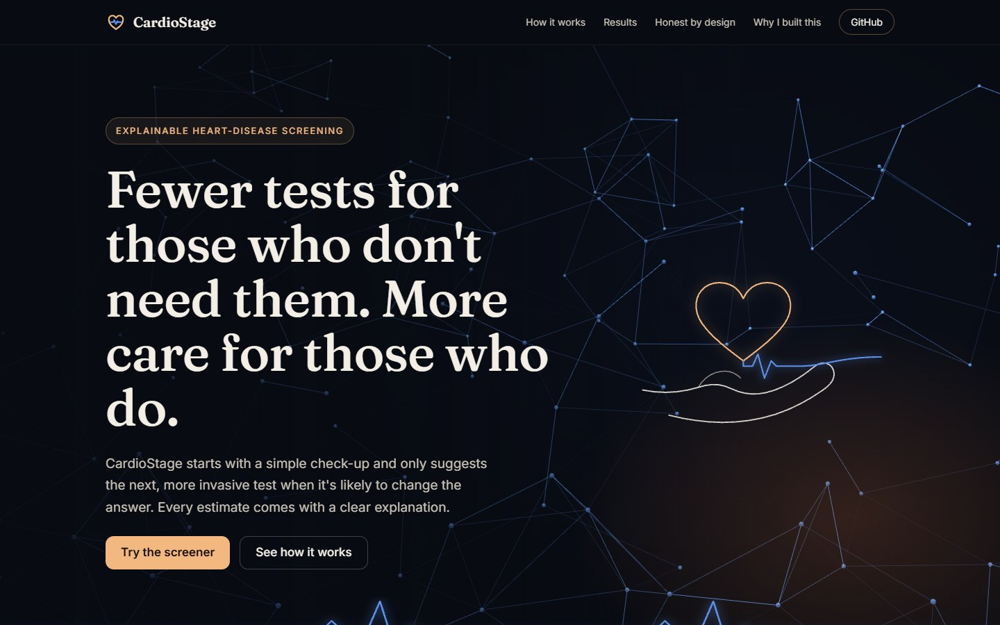
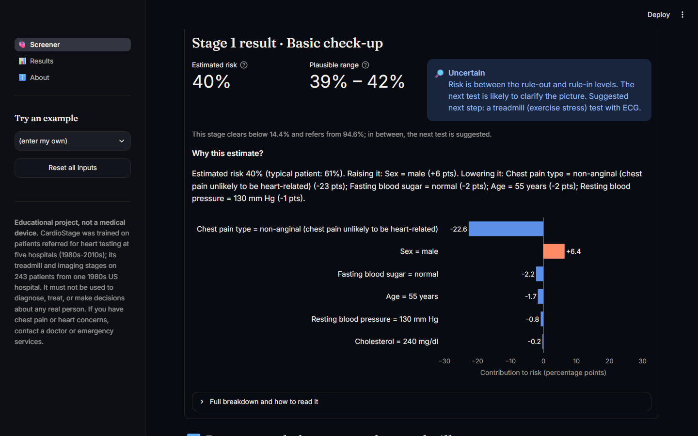
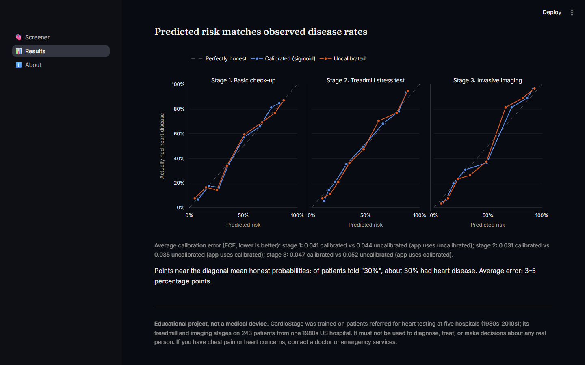
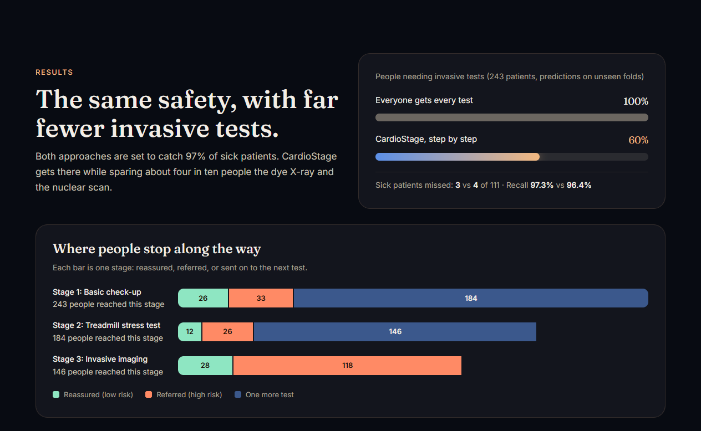

# CardioStage

**A heart-disease risk screener that works the way doctors order tests: cheapest first.**

CardioStage estimates heart-disease risk in three stages: a basic check-up, then a treadmill stress test, then invasive imaging. At each stage it decides whether the patient can be **cleared**, should be **referred**, or needs the **next test**. Every estimate is calibrated, explained in plain English, and flagged when the patient is unlike anyone the model has seen.

  

> ⚕️ **Educational project, not a medical device.** Trained on 243 patients from a 1980s dataset. Not for diagnosis or treatment decisions.

🩺 **Try the screener online:** [cardiostage.streamlit.app](https://cardiostage.streamlit.app/) (a short privacy notice comes first; it can take a minute or two to wake up after a quiet period).

🌐 **Project website:** [harshfiu.github.io/CardioStage](https://harshfiu.github.io/CardioStage/): the idea, results and limitations explained visually.

[](https://harshfiu.github.io/CardioStage/)

---

## Headline results

**Sealed test set:** 61 Cleveland patients, locked away from all development and opened once at the end, with thresholds frozen:

| Strategy | Sick missed (of 28) | Recall [95% CI] | Specificity | Needed invasive tests |
|---|---|---|---|---|
| Everyone gets every test | 0 | 1.000 [0.877, 1.000] | 0.455 | 100% |
| **CardioStage staged policy** | **0** | **1.000 [0.877, 1.000]** | **0.515** | **49%** |

**Cross-validation** (243 training patients, honest out-of-fold predictions, the more stable estimate): the staged policy matched all-tests recall (0.964 vs 0.973; difference −0.009 [−0.029, 0.000]) while needing **40% fewer invasive tests [33%, 46%]**.

**In one sentence:** CardioStage catches sick patients as reliably as testing everyone fully, while sparing roughly half of patients invasive imaging.


---

## How it works

| Stage | Measurements | What it takes | Model |
|---|---|---|---|
| 1. Basic check-up | age, sex, chest-pain type, blood pressure, cholesterol, blood sugar | Clinic visit + blood test | Logistic regression |
| 2. + Treadmill | resting ECG, max heart rate, exercise chest pain, ST depression, ST slope | ECG + stress test | Ensemble (LR + RF + XGBoost), Platt-calibrated |
| 3. + Invasive imaging | vessels seen on fluoroscopy, thallium scan | Hospital, dye/radiation | Ensemble, Platt-calibrated |

At stages 1–2, risk below a **rule-out** level (keeps ≥99% of sick patients above it) → cleared; above a **rule-in** level (≥90% of flagged truly sick) → referred; in between → next test. Stage 3 refers anyone above a threshold set to catch **97% of sick patients**.


## What makes it different

| | |
|---|---|
| **Staged screening** | Measures what each test actually adds, and gives expensive tests only to patients who need them |
| **Honest probabilities** | Calibrated risk (average error 3–5 points), a plausible range from 20 resampled models, and an unusual-patient warning |
| **Explanations** | Per-patient SHAP breakdown that adds up exactly to the risk shown. All 12 medical sanity checks pass |
| **External validation** | Tested unchanged at three hospitals it never saw |
| **Fairness analysis** | Performance by sex and age, with an honest account of the cases it misses |
| **Rigour** | Sealed test set, nested cross-validation, bootstrap and exact confidence intervals, 122 automated tests, CI |

## Key findings

**Each test's value:** ROC-AUC (cross-validation) rises from **0.84** (check-up) → **0.86** (+ treadmill) → **0.90** (+ invasive). Invasive imaging adds the most.

**Explanations:** as test results arrive, the model relies less on demographics. The influence of sex falls from 13 → 7 → 4 percentage points.
> *Estimated risk 91% (typical patient: 48%). Raising it: thallium scan = reversible defect (+12 pts); no chest pain (+8 pts); ST depression 3.4 mm (+6 pts). Lowering it: blocked vessels = 0 (−3 pts).*

**Unseen hospitals:**

| Hospital | Stage 1 AUC | Stage 2 AUC | Verdict |
|---|---|---|---|
| Hungary | 0.840 [0.79, 0.89] | 0.892 [0.85, 0.93] | Transfers fully |
| VA Long Beach | 0.718 [0.63, 0.80] | 0.741 [0.66, 0.83] | Clear drop (different population, missing data) |
| Switzerland | 0.767 [0.48, 0.95] | 0.776 [0.58, 0.96] | Undetermined: only 8 healthy patients |

Probabilities under-predict at high-disease hospitals, and a one-number **prior shift** fixes it (Switzerland ECE 0.26 → 0.04). Decision cutoffs need local re-validation.

**Model choice:** logistic regression, random forest and XGBoost were statistically tied (ROC-AUC 0.89–0.90). On small data, the simple model is at least as good. A [from-scratch numpy logistic regression](src/cardiostage/from_scratch.py) reproduces scikit-learn's weights to 6 decimal places.

## Limitations
- **Small, old, single-site training data:** 243 patients from one US hospital in the 1980s.
- **Referral population:** everyone was already sent for heart testing, so patterns like "no chest pain → higher risk" don't apply to the general public.
- **Thresholds are local:** at Hungary the stage-1 clear zone was less safe (NPV 90% vs 96%).
- **Stage 3 not externally validated:** other hospitals lacked invasive test data.
- **Atypical presentations:** a woman with atypical chest pain was cleared at stage 1 in testing, mirroring real-world under-diagnosis of women. Documented rather than "fixed" with a rule fitted to 2 patients.
- **Explanations describe the model, not biology.**

## The app

```bash
streamlit run app/streamlit_app.py
```

- **Screener:** enter check-up details, get risk + range + recommendation + explanation, then add test results stage by stage. Four example patients, including one that deliberately shows a known limitation.
- **Results:** the evidence, with charts.
- **About:** method, data and limitations.

| Screener: a stage-1 result with its explanation | Results: the evidence, as interactive charts |
|---|---|
|  |  |

## The website

A separate static landing page in [`site/`](site/) explains the project for non-specialists: how the stages work, the results as interactive charts, how it stays honest, and why it was built. It uses smooth scrolling ([Lenis](https://github.com/darkroomengineering/lenis)), scroll animations ([GSAP](https://gsap.com)) and an animated hero background ([Vanta.js](https://www.vantajs.com) NET). All of these are stored in the repo, so the page loads nothing from other websites, and the motion switches off for visitors who prefer reduced motion. Every number on it is generated from the real results:

```bash
python -m cardiostage.site_data              # refresh the site's numbers after retraining
python -m http.server 8000 --directory site  # preview at http://localhost:8000
```



It's published to GitHub Pages automatically by `.github/workflows/pages.yml`. Third-party credits: [`site/licenses/NOTICES.html`](site/licenses/NOTICES.html).

## Quick start

```bash
git clone https://github.com/harshfiu/CardioStage.git
cd CardioStage
uv sync                                      # exact, checksum-verified environment from uv.lock
uv run python -m cardiostage.train_all       # build all models (~10 minutes, once)
#   ...or download the released ones instead (~270 MB, fingerprint-checked):
#   uv run python -m cardiostage.model_store download
uv run pytest                                # 122 tests
uv run streamlit run app/streamlit_app.py
```

Needs [uv](https://docs.astral.sh/uv/) (`pip install uv` or see its install page); it also fetches Python 3.12 if you don't have it. **Without uv:** create and activate a virtual environment, then `pip install -r requirements.txt --require-hashes` and `pip install -e . --no-deps`. `requirements.txt` is generated from `uv.lock` and every package is checked against its recorded checksum.

Reproduce any phase's analysis, e.g. `python -m cardiostage.external_validation`. Each module's docstring lists its command.

## Project structure

```
├── app/                    Streamlit app: entry point, views/, shared ui.py
├── data/raw/               original UCI dataset (never edited)
├── docs/learning/          13 step-by-step guides: how and why every part was built
├── docs/project/           PRD, models, design system and architecture documents
├── brain/security/         threat model, secrets, attack surface, security checklist
├── models/                 trained models (generated by train_all, not in Git)
├── reports/                result tables (CSV) and figures/
├── site/                   the project website (static; GitHub Pages)
├── src/cardiostage/
│   ├── config.py           paths, stages, thresholds: one source of truth
│   ├── data.py             loading, cleaning, the sealed train/test split
│   ├── preprocessing.py    leakage-safe imputation, scaling, encoding
│   ├── models.py           model pipelines and tuning grids
│   ├── staging.py          per-stage selection, decision zones, policy simulation
│   ├── calibration.py      calibration, uncertainty evaluation, final models
│   ├── uncertainty.py      plausible ranges, unusual-patient detection
│   ├── external_validation.py, fairness.py, final_evaluation.py
│   ├── explain.py          SHAP explanations in plain English
│   ├── predictor.py        the app's decision engine
│   ├── site_data.py        exports the website's numbers from the reports
│   └── from_scratch.py     logistic regression in pure numpy
├── tests/                  122 automated tests (incl. security, website and charts)
└── tools/                  screenshots.py: regenerates the README screenshots
```

## Security
The app runs **on your computer only** (it listens on `localhost`), validates every input on the server, never shows error internals to users, rate-limits assessments, and refuses to load model files whose SHA-256 fingerprint doesn't match the one recorded at build time. CI runs linting, tests, a dependency vulnerability audit (`pip-audit`) and a secret scan (gitleaks) on every push. The full assessment (threat model, secrets, attack surface, checklist) is in [`brain/security/`](brain/security/threat-model.md).

> To share the app on a trusted network on purpose: `streamlit run app/streamlit_app.py --server.address 0.0.0.0`. There's no login or encryption, so never do this on public Wi-Fi.

## Project documents
[`docs/project/`](docs/project/README.md) holds the full reference, kept up to date with every change: the [product requirements](docs/project/01-product-requirements.md), [models](docs/project/02-models.md) (every hyperparameter, threshold and metric), [design system](docs/project/03-design-system.md) and [architecture](docs/project/04-architecture.md).

## Learning guides
New to ML? [`docs/learning/`](docs/learning/README.md) walks through every phase: setup, data leakage, nested cross-validation, thresholds, calibration, external validation, fairness, SHAP, the app, final evaluation, security hardening, the website, locking the supply chain and going online. Each guide ends with questions and answers.

## Data & licence
**Data:** [UCI Heart Disease dataset](https://archive.ics.uci.edu/dataset/45/heart+disease) (Janosi, Steinbrunn, Pfisterer & Detrano, 1988), CC BY 4.0, via the [Kaggle mirror](https://www.kaggle.com/datasets/redwankarimsony/heart-disease-data). See [`data/README.md`](data/README.md).
**Code:** [MIT License](LICENSE). **Website libraries and fonts:** Lenis, three.js and Vanta (MIT), Fraunces and Inter (SIL OFL), GSAP (standard "no charge" licence); see [`site/licenses/`](site/licenses/).

## Disclaimer
CardioStage is an educational machine-learning project. **It is not a medical device and must not be used for diagnosis, treatment, or any decision about a real person.** If you have chest pain or heart concerns, contact a doctor or emergency services.
