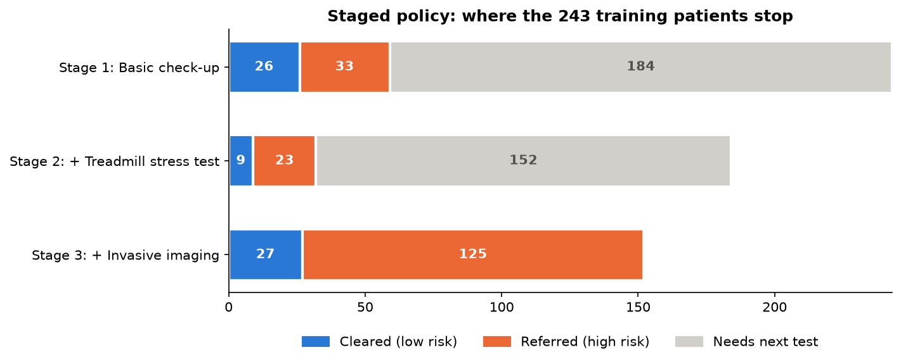
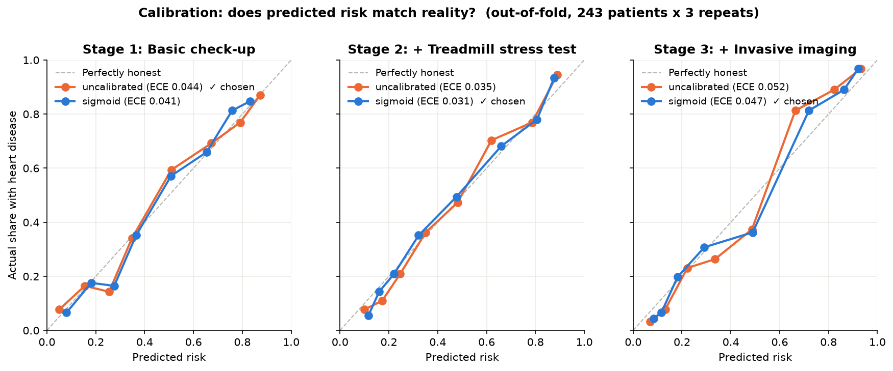
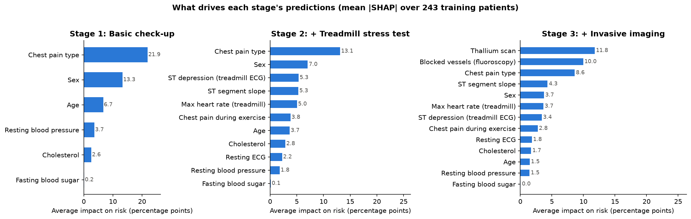
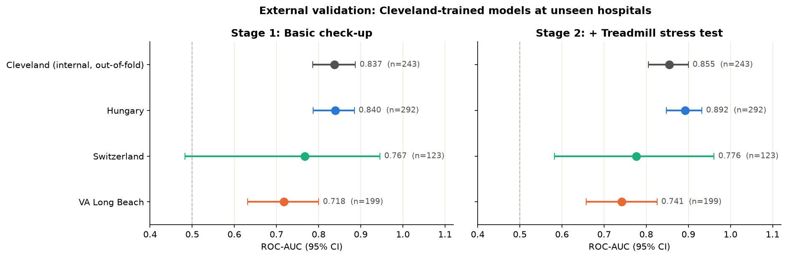

# CardioStage

**A heart-disease risk screener that works the way doctors order tests: cheapest first.**

CardioStage estimates heart-disease risk in stages. It starts from a basic check-up, then adds a treadmill stress test, then invasive imaging. At each stage it answers *"is the next test worth it?"*, explains its reasoning, admits when it isn't sure, and is tested on hospitals it has never seen.

> 🚧 **Work in progress.** Built in phases; see the roadmap below.

## What makes it different

| Feature | What it does |
|---|---|
| **Staged screening** | Separate models for basic info → + treadmill test → + invasive imaging, showing how much each test actually adds |
| **Cross-hospital testing** | Trained on Cleveland, evaluated on Hungary, Switzerland and VA Long Beach to measure real-world generalisation |
| **Explanations** | Per-patient SHAP breakdown of what drove each prediction, in plain English |
| **Honest probabilities** | Calibrated risk scores, plus a "not confident" answer for borderline or unusual patients |
| **Fairness check** | Performance compared across sex and age groups |

## Roadmap
- [x] Phase 1: Project setup
- [x] Phase 2: Data exploration & cleaning
- [x] Phase 3: Baseline models (Logistic Regression, Random Forest, XGBoost)
- [x] Phase 4: Staged screening
- [x] Phase 5: Calibration & uncertainty
- [x] Phase 6: Cross-hospital & fairness evaluation
- [x] Phase 7: Explanations (SHAP)
- [x] Phase 8: Streamlit app
- [ ] Phase 9: Polish

## Setup
```bash
python -m venv .venv
.venv\Scripts\activate          # Windows  (Mac/Linux: source .venv/bin/activate)
pip install -r requirements.txt
pip install -e .
python -m cardiostage.train_all # build the models (~10 minutes, once)
pytest                          # verify everything (58 tests)
streamlit run app/streamlit_app.py
```

## The app
Enter a patient's basic check-up details and CardioStage returns a calibrated risk, a plausible range, an unusual-patient warning when relevant, and a plain-English explanation. It then recommends clearing, referring, or taking the next test. Treadmill and imaging results can be added step by step. Four example patients include one that deliberately demonstrates a known limitation. Results and About pages present the evidence and the caveats.

## Project structure
```
├── app/                 Streamlit app (entry point + views/)
├── data/
│   ├── raw/             original dataset, never edited
│   └── processed/       cleaned data (generated)
├── docs/learning/       step-by-step guides explaining every phase
├── models/              trained models (generated)
├── reports/figures/     charts
├── src/cardiostage/     the Python package: all project logic
└── tests/               automated checks
```

## Data
UCI Heart Disease dataset (920 patients, 4 hospitals). See [`data/README.md`](data/README.md).

**Key finding:** the four hospitals recorded different tests. Invasive Stage 3 tests exist almost only for Cleveland, and Switzerland never recorded cholesterol. This shapes how the staged models are trained and evaluated.


## Staged screening results
Each patient starts with a basic check-up. Low-risk patients are cleared, high-risk patients are referred, and only uncertain patients go on to the treadmill test and then invasive imaging. All strategies are tuned to catch **97% of sick patients** (calibrated out-of-fold predictions, 243 Cleveland training patients):

| Strategy | Recall | Specificity | Need invasive tests |
|---|---|---|---|
| Everyone gets every test | 0.973 | 0.447 | 100% |
| **CardioStage staged policy** | **0.964** | **0.470** | **60%** |

Bootstrap 95% CI for the difference: recall −0.009 [−0.029, 0.000], invasive tests **−40% [−46%, −33%]**. The staged policy matches giving everyone every test while sparing about 40% of patients invasive imaging.



## Honest probabilities
- **Calibrated:** predicted risk matches observed disease rates (pooled ECE 0.03–0.05; sigmoid calibration on stages 2–3).
- **Plausible risk range:** 20 models trained on different patient subsets show how stable each prediction is. Shown for transparency; it proved a weak error detector, so it doesn't change decisions.
- **Unusual-patient warning:** flags out-of-range values or unusual combinations. It fires on ~1% of training patients but up to 13% at hospitals with very different populations.



## Explanations
Every prediction is broken down with SHAP into plain-English contributions that add up exactly to the risk shown, for example:

> Estimated risk 91% (typical patient: 48%). Raising it: thallium scan = reversible defect (+12 pts); no chest pain (+8 pts); ST depression 3.4 mm (+6 pts). Lowering it: blocked vessels = 0 (−3 pts).

All 12 medical direction checks pass. As test results arrive, the model relies less on demographics: the influence of sex falls from 13.3 → 7.0 → 3.7 points across the stages.



## External validation (unseen hospitals)
Stage models trained only on Cleveland, applied unchanged to three other hospitals:

| Hospital | Disease rate | Stage 1 AUC | Stage 2 AUC |
|---|---|---|---|
| Cleveland (internal, out-of-fold) | 46% | 0.837 | 0.855 |
| Hungary | 36% | 0.840 [0.79, 0.89] | 0.892 [0.85, 0.93] |
| VA Long Beach | 74% | 0.718 [0.63, 0.80] | 0.741 [0.66, 0.83] |
| Switzerland | 93% | 0.767 [0.48, 0.95]* | 0.776 [0.58, 0.96]* |

\*Only 8 healthy Swiss patients, so performance there is undetermined. Ranking transfers well to Hungary and degrades at VA. Probabilities under-predict at high-prevalence hospitals, which a one-number **prior shift** corrects (Switzerland ECE 0.26 → 0.04). Decision cutoffs need local re-checking: the stage-1 clear zone was less safe at Hungary (NPV 90% vs 96%).



## Fairness
Ranking quality is equal for women and men, both internally and externally. Recall for women was 0.89 [0.72, 1.00] vs 0.98 for men, based on 2 missed women out of 18. One case reflects the known under-diagnosis of atypical presentations; the other sat exactly on the threshold. This is documented as a limitation rather than "fixed" with a rule fitted to two patients.

## Model comparison
Nested cross-validation (5 folds × 3 repeats, tuning inside each fold) on 243 Cleveland training patients, using all features:

| Model | ROC-AUC | Recall | Precision |
|---|---|---|---|
| Logistic Regression | 0.899 ± 0.028 | 0.778 | 0.856 |
| Random Forest | 0.894 ± 0.021 | 0.775 | 0.820 |
| XGBoost | 0.892 ± 0.025 | 0.778 | 0.822 |

The models are statistically tied. On this small dataset, the simple, interpretable model is at least as good as the tree ensembles. A from-scratch numpy logistic regression ([`from_scratch.py`](src/cardiostage/from_scratch.py)) reproduces scikit-learn's weights to 6 decimal places.

## Disclaimer
CardioStage is an educational machine-learning project. **It is not a medical device and must not be used for diagnosis or treatment decisions.**
