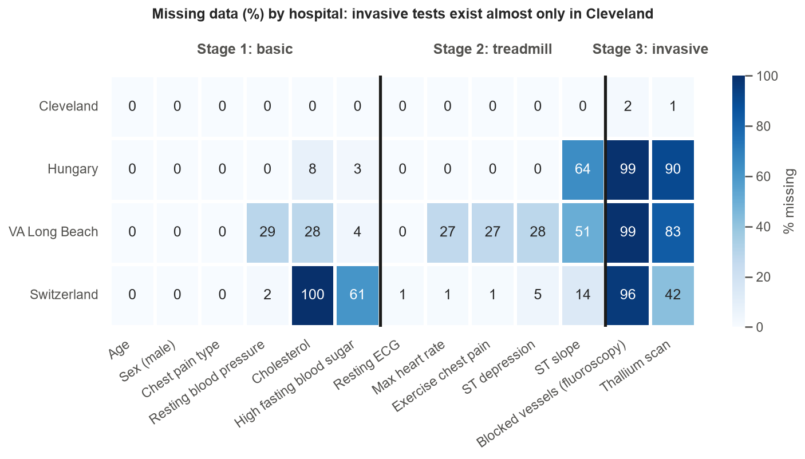

# CardioStage

**A heart-disease risk screener that works the way doctors order tests: cheapest first.**

CardioStage estimates heart-disease risk in stages. It starts from a basic check-up, then adds a treadmill stress test, then invasive imaging. At each stage it answers *"is the next test worth it?"*, explains its reasoning, admits when it isn't sure, and is tested on hospitals it has never seen.

> 🚧 **Work in progress.** Built in phases; see the roadmap below.

## What makes it different

| Feature | What it does |
|---|---|
| **Staged screening** | Separate models for basic info → + treadmill test → + invasive imaging, showing how much each test actually adds |
| **Cross-hospital testing** | Trained on Cleveland, evaluated on Hungary, Switzerland and VA Long Beach to measure real-world generalisation |
| **Explanations** | Per-patient SHAP breakdown of what drove each prediction, in plain English |
| **Honest probabilities** | Calibrated risk scores, plus a "not confident" answer for borderline or unusual patients |
| **Fairness check** | Performance compared across sex and age groups |

## Roadmap
- [x] Phase 1: Project setup
- [x] Phase 2: Data exploration & cleaning
- [x] Phase 3: Baseline models (Logistic Regression, Random Forest, XGBoost)
- [x] Phase 4: Staged screening
- [ ] Phase 5: Calibration & uncertainty
- [ ] Phase 6: Cross-hospital & fairness evaluation
- [ ] Phase 7: Explanations (SHAP)
- [ ] Phase 8: Streamlit app
- [ ] Phase 9: Polish

## Setup
```bash
python -m venv .venv
.venv\Scripts\activate          # Windows  (Mac/Linux: source .venv/bin/activate)
pip install -r requirements.txt
pip install -e .
pytest                          # verify everything is in place
```

## Project structure
```
├── app/                 Streamlit app (Phase 8)
├── data/
│   ├── raw/             original dataset, never edited
│   └── processed/       cleaned data (generated)
├── docs/learning/       step-by-step guides explaining every phase
├── models/              trained models (generated)
├── reports/figures/     charts
├── src/cardiostage/     the Python package: all project logic
└── tests/               automated checks
```

## Data
UCI Heart Disease dataset (920 patients, 4 hospitals). See [`data/README.md`](data/README.md).

**Key finding:** the four hospitals recorded different tests. Invasive Stage 3 tests exist almost only for Cleveland, and Switzerland never recorded cholesterol. This shapes how the staged models are trained and evaluated.



## Staged screening results
Each patient starts with a basic check-up. Low-risk patients are cleared, high-risk patients are referred, and only uncertain patients go on to the treadmill test and then invasive imaging. All strategies are tuned to catch **97% of sick patients** (out-of-fold predictions, 243 Cleveland training patients):

| Strategy | Recall | Specificity | Need invasive tests |
|---|---|---|---|
| Everyone gets every test | 0.973 | 0.432 | 100% |
| **CardioStage staged policy** | **0.964** | **0.439** | **63%** |

Bootstrap 95% CI for the difference: recall −0.009 [−0.029, 0.000], invasive tests **−37% [−44%, −31%]**. The staged policy matches giving everyone every test while sparing over a third of patients invasive imaging.


## Model comparison
Nested cross-validation (5 folds × 3 repeats, tuning inside each fold) on 243 Cleveland training patients, using all features:

| Model | ROC-AUC | Recall | Precision |
|---|---|---|---|
| Logistic Regression | 0.899 ± 0.028 | 0.778 | 0.856 |
| Random Forest | 0.894 ± 0.021 | 0.775 | 0.820 |
| XGBoost | 0.892 ± 0.025 | 0.778 | 0.822 |

The models are statistically tied. On this small dataset, the simple, interpretable model is at least as good as the tree ensembles. A from-scratch numpy logistic regression ([`from_scratch.py`](src/cardiostage/from_scratch.py)) reproduces scikit-learn's weights to 6 decimal places.

## Disclaimer
CardioStage is an educational machine-learning project. **It is not a medical device and must not be used for diagnosis or treatment decisions.**
