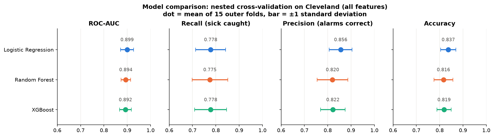
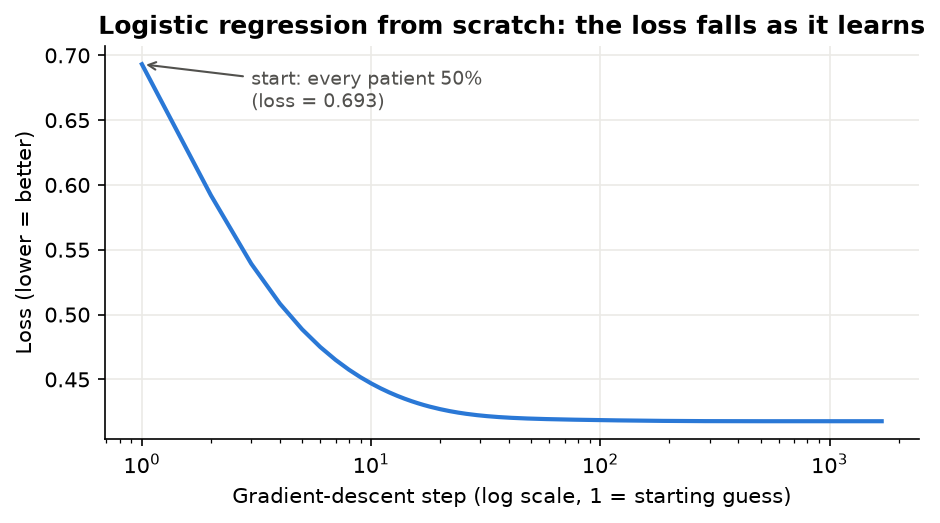

# Phase 3: Baseline Models

**Goal:** find out which kind of model works best on this data, measured honestly, and understand what "training" actually means by building one model from scratch.

**Files in this phase**

| File | Job |
|---|---|
| `src/cardiostage/data.py` | New `split_cleveland()`: the sealed train/test split |
| `src/cardiostage/models.py` | The 3 model pipelines and their hyperparameter grids |
| `src/cardiostage/train_baselines.py` | Nested cross-validation comparison, saves results + chart |
| `src/cardiostage/from_scratch.py` | Logistic regression in pure numpy |
| `tests/test_models.py` | 8 checks (split, pipelines, from-scratch matches scikit-learn) |

```bash
python -m cardiostage.train_baselines   # ~1-2 minutes
python -m cardiostage.from_scratch
```

---

## 1. The sealed test set

We split Cleveland's 304 patients into:
- **243 training patients (80%):** everything we do in Phases 3–7 uses only these.
- **61 test patients (20%):** **sealed**. Opened once, at the very end, to report final numbers.

Think of it as a final exam. If a student sees the exam questions while studying, their grade no longer measures what they learned. Every time we *look* at test results and then change something, we leak a little exam information into our decisions. So the test set stays locked.

Two details in `split_cleveland()`:
- **`stratify`** keeps the disease rate the same (~46%) in both parts. With 61 patients, a random split could easily end up 55% sick in test, making scores misleading.
- **`random_state`** fixes the split so it's **the same 61 patients in every phase**. A test checks this.

## 2. Cross-validation: grading without the test set

If we can't use the test set, how do we compare models? **Cross-validation (CV).**

5-fold CV on the 243 training patients:
```
Fold 1:  [TEST ][train][train][train][train]   -> score 1
Fold 2:  [train][TEST ][train][train][train]   -> score 2
...
Fold 5:  [train][train][train][train][TEST ]   -> score 5
                                         average = CV score
```
Each patient is used for grading exactly once, and the model is never graded on patients it trained on. We **repeat this 3 times** with different shuffles (15 scores total), because with small data one particular split can be lucky or unlucky. The spread of the 15 scores (the "± std") tells us how much to trust the average.

## 3. Nested cross-validation: honest tuning

Each model has **hyperparameters**: settings we choose, like how deep XGBoost's trees can grow. We pick them with a **grid search**: try every combination and keep the one with the best CV score.

**The trap:** if you tune on CV folds and then report that *same* best CV score, the score is optimistic. The winning settings won partly because they happened to suit those particular folds. With 18–24 combinations, one is bound to get lucky.

**The fix, nested CV:**
```
OUTER loop (grading, 5 folds × 3 repeats):
    hold out one outer fold
    INNER loop (tuning): grid search with 5-fold CV on the remaining data only
    train the winner, grade it on the held-out outer fold
```
The outer fold never influences the tuning, so the outer scores honestly estimate *"how good is this whole tune-and-train recipe on new patients?"*. Many tutorials skip this. Doing it properly is a mark of rigour that interviewers notice.

After grading, we run the grid search once more on all 243 patients to produce the final model of each type (saved in `models/`).

## 4. The three models

### Logistic regression: a weighted checklist
```
risk score = w1·age + w2·cholesterol + w3·exercise_pain + ... + b
probability = sigmoid(risk score)        (squashes any number into 0–1)
```
Each feature gets one **weight**. Positive raises risk, negative lowers it. Training finds the weights that best fit the data (section 7 shows how).
- ✅ Simple, fast, **easy to interpret**: you can read the weights directly.
- ❌ Assumes each feature pushes risk in one consistent direction, so it can't natively capture interactions like "high cholesterol matters more for older patients".

**Its hyperparameter, `C` (regularisation):** a penalty on big weights that keeps the model cautious. Small C = strong penalty = simpler model. It stops the model from over-trusting quirks of 243 patients.

### Random Forest: a committee of decision trees
A **decision tree** is a flowchart of yes/no questions:
```
Thallium scan normal?
├── yes → Max heart rate > 150?
│         ├── yes → 10% risk
│         └── no  → 45% risk
└── no  → Blocked vessels ≥ 1? → ...
```
One tree **overfits**: it memorises the training patients. A **random forest** grows 300 trees, each on a random sample of patients and considering random subsets of features, then **averages their votes**. Individual trees' errors cancel out.
- ✅ Captures interactions and non-linear patterns automatically.
- ❌ Harder to interpret; needs more data to shine.

Hyperparameters: `max_depth` (questions per tree), `min_samples_leaf` (minimum patients per final group: larger = smoother), `max_features` (features each split considers).

### XGBoost: trees that learn from mistakes
Also many trees, but built **one after another**. Each new tree focuses on the patients the previous trees got wrong ("gradient boosting"), and its correction is scaled by a **learning rate**.
- ✅ Often the best on large tabular datasets; it wins many Kaggle competitions.
- ❌ More settings to tune, easier to overfit on small data.

## 5. Metrics: what "good" means in medicine

Every yes/no prediction falls into one of 4 boxes (a **confusion matrix**). Imagine 100 patients, 46 actually sick:

|  | Predicted sick | Predicted healthy |
|---|---|---|
| **Actually sick (46)** | ✅ True positive: 36 | ❌ **False negative: 10** (missed!) |
| **Actually healthy (54)** | ⚠️ False positive: 6 (false alarm) | ✅ True negative: 48 |

| Metric | Formula | In this example | Plain English |
|---|---|---|---|
| **Recall** | TP / all sick | 36/46 = 78% | Of the sick, how many did we catch? |
| **Precision** | TP / all flagged | 36/42 = 86% | When we raise an alarm, how often is it real? |
| **Accuracy** | correct / all | 84/100 = 84% | Overall fraction right |
| **ROC-AUC** | (see below) | | How well the model *ranks* patients by risk |

**Why accuracy isn't enough:** a missed sick patient (false negative) can be fatal, while a false alarm means an extra test. These mistakes aren't equal, but accuracy treats them as equal. In screening, **recall matters most**.

**ROC-AUC:** pick a random sick patient and a random healthy patient. ROC-AUC is the probability that the model gives the sick one a higher risk score. 0.5 = coin flip, 1.0 = perfect ranking. Its big advantage is that it **doesn't depend on the 0.5 threshold**. Recall and precision do: lower the threshold to 0.3 and recall rises while precision falls. Choosing the threshold is part of Phase 4.

## 6. Results



| Model | ROC-AUC | Recall | Precision | Accuracy |
|---|---|---|---|---|
| **Logistic Regression** | **0.899 ± 0.028** | 0.778 | **0.856** | **0.837** |
| Random Forest | 0.894 ± 0.021 | 0.775 | 0.820 | 0.816 |
| XGBoost | 0.892 ± 0.025 | 0.778 | 0.822 | 0.819 |

**How to read this:**
1. **It's a tie.** The differences (0.899 vs 0.892) are far smaller than the spread (± 0.02–0.03). Run it with a different seed and the order could flip. Claiming "logistic regression is better" would be overclaiming. The honest statement is *"no model is meaningfully better; logistic regression is at least as good"*.
2. **Why didn't the fancy models win?** With 243 patients and 13 mostly simple features, there isn't enough data for trees to discover complex patterns that logistic regression misses. Their extra flexibility mostly adds variance. This is a well-known result on small medical datasets, and it's a great interview talking point.
3. **Recall of ~78%** at the default 0.5 threshold means about 1 in 5 sick patients is missed. That's too many for screening. We'll fix it in Phase 4 by choosing a lower threshold on purpose.
4. **Stability of settings:** logistic regression picked C = 0.1 or 0.3 in 14 of 15 outer folds, which is very stable. Random forest picked 9 different combinations, a sign that its settings barely matter on this data. That's another hint that the simpler model is the safer choice.

**What we carry forward:** we keep all 3 model types for Phase 4 and compare them again at each stage. Fewer features might change the picture.

## 7. Logistic regression from scratch (`from_scratch.py`)

Training a model means solving: *which weights make the predictions match reality best?* Our numpy version does it in 5 steps:

1. **Start knowing nothing.** All weights = 0, so every patient gets sigmoid(0) = **50%**.
2. **Predict** with the current weights.
3. **Measure the error with log loss.** For a sick patient, predicting 90% costs 0.11, but a confident wrong 10% costs 2.30. Confident mistakes are punished hard.
4. **Compute the gradient.** For each weight, which direction would reduce the loss? Calculus gives a neat formula: `gradient = average of (prediction − truth) × feature`. If a feature is high precisely when we under-predict sick patients, the gradient says "raise this weight".
5. **Gradient descent.** Nudge every weight a small step downhill (step size = learning rate), then repeat from step 2 until the loss stops improving.



The loss falls from 0.693 (coin flip) to about 0.42 within ~30 steps, then fine-tunes. It converges after about 1,700 steps.

**The result: our 60 lines of numpy learn the same weights as scikit-learn, to 6 decimal places** (largest difference 0.000002). A test (`test_scratch_matches_scikit_learn`) guarantees it stays that way.

### What the model learned (the weights)
Features are standardised, so weights are comparable in size:

| Raises risk | Weight | | Lowers risk | Weight |
|---|---|---|---|---|
| Blocked vessels (`ca`) | +0.69 | | Normal thallium scan | −0.51 |
| No chest pain (asymptomatic) | +0.58 | | Higher max heart rate | −0.32 |
| Reversible thallium defect | +0.52 | | Non-anginal chest pain | −0.31 |
| Male | +0.52 | | Upsloping ST segment | −0.25 |
| Exercise chest pain | +0.37 | | | |

These match the medical picture from Phase 2: blocked vessels, active blood-flow defects and exercise-induced pain are the strongest warnings, while a heart that reaches a high rate under stress is reassuring.

**Surprise: age has a weight of ≈ 0.** Age clearly differs between sick and healthy patients (Phase 2 chart), so why? Because its information is **already carried by other features**. Older patients tend to have lower max heart rates and more blocked vessels. Once the model knows those, age adds little on its own. **Weights show a feature's *extra* contribution given all the others, not its importance in isolation.** Keep this in mind for Phase 7's explanations.

## 8. Check your understanding
1. Why don't we use the 61 test patients to choose between models?
2. What problem does *nested* cross-validation solve that ordinary cross-validation doesn't?
3. Logistic regression scored 0.899 and XGBoost 0.892. Can we say logistic regression is better?
4. A model has 95% accuracy but 40% recall. Is it a good screening tool?
5. Why does the from-scratch model start by predicting 50% for everyone?

## Answers

**1.** Choosing a model *is* a decision. If we pick the model with the best test score, the test set has influenced our choice, and its score is no longer an unbiased estimate of performance on new patients. We'd be grading ourselves on an exam we studied for. Model selection uses cross-validation on training data, and the test set is opened once at the end.

**2.** When you tune hyperparameters with CV and report the best CV score, that score is optimistic: the winning settings were selected *because* they scored well on those exact folds, partly by luck. Nested CV tunes inside an inner loop and grades on outer folds that played no part in tuning, so the reported score honestly reflects new data.

**3.** No. The gap (0.007) is much smaller than the standard deviation across folds (~0.025), so it's within noise. A different random split could reverse the order. The correct conclusion is that the models perform equivalently, and logistic regression is at least as good while being simpler and more interpretable.

**4.** No. 40% recall means it misses 60% of sick patients. The high accuracy probably comes from correctly calling healthy people healthy. For screening, missing disease is the costly error, so recall must be high, even at the price of more false alarms.

**5.** All weights start at 0, so the weighted sum is 0 for every patient, and sigmoid(0) = 0.5. It's the "know nothing" starting point. Gradient descent then moves the weights step by step toward values that fit the data.
