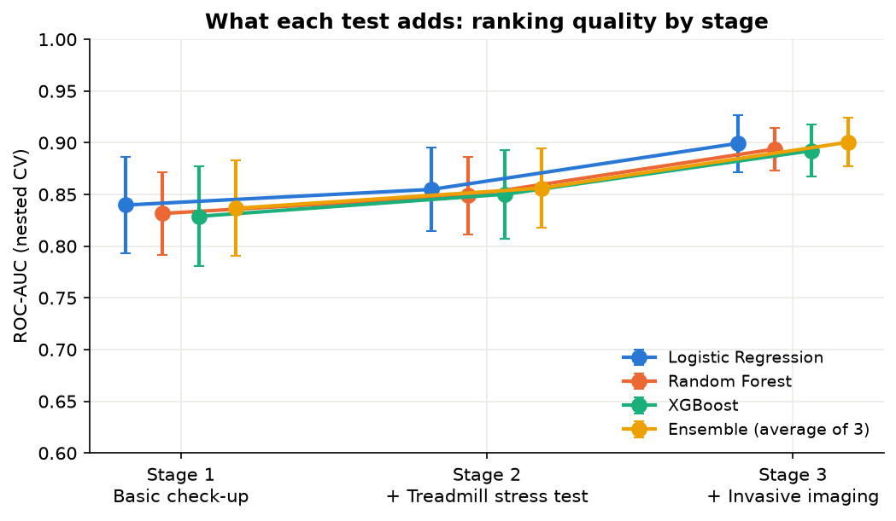
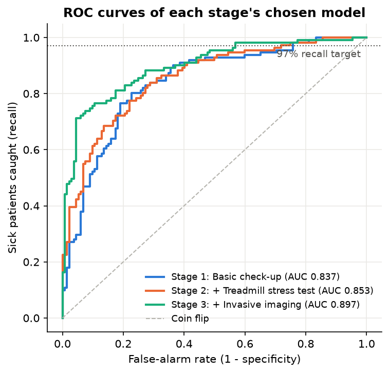
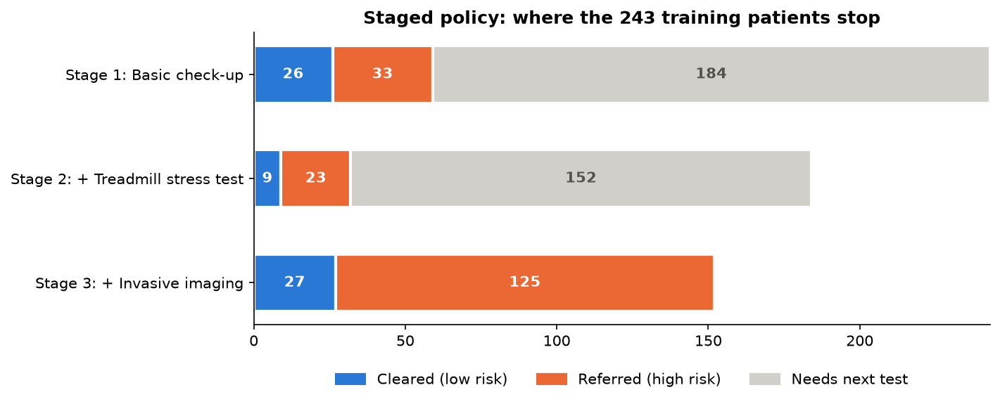

# Phase 4: Staged Screening

**Goal:** build CardioStage's headline feature, a screener that works the way doctors order tests (cheapest first), and measure whether it's worth it.

**Files in this phase**

| File | Job |
|---|---|
| `src/cardiostage/thresholds.py` | Turns probabilities into decisions (recall/precision-based thresholds, metrics) |
| `src/cardiostage/staging.py` | Per-stage model comparison, decision zones, policy simulation, bootstrap, charts, final models |
| `tests/test_staging.py` | 9 checks on threshold logic and patient routing |
| `models/stage{1,2,3}.joblib` | The final model for each stage plus its decision zones (generated, not in Git) |

```bash
python -m cardiostage.staging    # ~3 minutes
```

---

## 1. Why "more epochs" or a GPU wouldn't help

**Epochs** (passes over the training data) matter for neural networks trained on huge datasets. Our models are different:
- **Logistic regression** is solved to the exact optimum in milliseconds. Phase 3's from-scratch version shows the loss going flat, and more steps change nothing.
- **Tree models** don't train in epochs at all. Their capacity is controlled by hyperparameters, which we already tune.

With 243 patients, the limit is **information, not computation**. Pushing models to fit the training data harder makes them memorise those patients (**overfitting**): training scores go up while performance on new patients goes down. A GPU would actually be *slower* here; moving such tiny data to the GPU costs more than the computation itself.

What *does* reduce mistakes in screening: choosing thresholds on purpose, combining models, and getting more information (the next test) for uncertain patients. That's this phase.

## 2. Method: honest "unseen" predictions for every patient

We repeat Phase 3's nested cross-validation **for each stage**, with 4 candidates: the 3 models plus an **ensemble** that averages their probabilities. Different model types make different mistakes, so averaging often cancels some of them out.

The key addition is **out-of-fold (OOF) predictions**. In each outer fold, the patients in the held-out fold get a probability from a model that **never saw them**. After all folds, every one of the 243 patients has an honest "as if new" probability at stage 1, 2 and 3. Because all stages use **the same folds**, we can walk each real patient through the staged policy and count the outcomes.

## 3. What each test adds



| Stage | Best model | ROC-AUC |
|---|---|---|
| 1. Basic check-up | Logistic Regression | 0.840 ± 0.046 |
| 2. + Treadmill | Ensemble | 0.856 ± 0.038 |
| 3. + Invasive imaging | Ensemble | **0.900 ± 0.024** |

- **The treadmill test adds a little** (+0.016): useful, but modest.
- **Invasive imaging adds the most** (+0.044): blocked vessels and thallium results are very informative.
- **The basic check-up alone is already decent** (0.84): age, sex, chest-pain type, blood pressure, cholesterol and blood sugar carry a lot of signal.
- Again, all 4 candidates are within noise of each other. The ensemble wins stages 2–3 by a hair.



**How to read ROC curves:** each curve shows every possible threshold. Moving right means a lower threshold: more sick patients caught (up), but more false alarms (right). A curve hugging the top-left corner is better.

**The insight hiding in this chart:** the stage 3 curve is far above the others on the **left side**, the "confident" region. At a 5% false-alarm rate, stage 3 catches about 70% of sick patients and stage 1 only about 30%. So invasive tests are most valuable for **confident decisions**, which is exactly what the staged policy exploits.

## 4. Three kinds of threshold

`thresholds.py` chooses thresholds from the data, based on which mistake is worse:

| Zone | Rule | Meaning |
|---|---|---|
| **Rule-out** (LOW) | Highest threshold that still keeps ≥ **99%** of sick patients above it | "Low enough risk that further tests are unlikely to change anything" |
| **Rule-in** (HIGH) | Lowest threshold where ≥ **90%** of flagged patients are truly sick | "Confident enough to refer straight to a cardiologist" |
| **Screening** (final stage) | Highest threshold catching ≥ **97%** of sick patients | The final yes/no for anyone who reaches stage 3 |

**Worked example of `threshold_for_recall`:** 111 sick patients, target 97% → we may miss at most ⌊0.03 × 111⌋ = 3. Sort the sick patients' probabilities from low to high; the threshold is the 4th-lowest value. Only the 3 below it are missed, and any higher threshold would miss a 4th.

Learned thresholds:
- Stage 1: clear if risk < 9.0%, refer if ≥ 83.0%, otherwise → treadmill.
- Stage 2: clear if risk < 12.5%, refer if ≥ 78.2%, otherwise → invasive tests.
- Stage 3: refer if risk ≥ 17.2%.

(These are uncalibrated model scores. Phase 5 makes the probabilities honest and re-derives the thresholds.)

## 5. The staged policy in action



| Where patients stop | Cleared | …truly sick | Referred | …truly sick |
|---|---|---|---|---|
| Stage 1 (basic) | 26 | 1 | 33 | 30 (91%) |
| Stage 2 (treadmill) | 9 | 1 | 23 | 21 (91%) |
| Stage 3 (invasive) | 27 | 2 | 125 | 56 |

59 patients (24%) get a confident answer from a check-up alone, and 32 more after the treadmill. **91 of 243 patients never need invasive tests.**

## 6. Is it worth it? The comparison

Every strategy is tuned to the same **97% recall** target (243 training patients: 111 sick, 132 healthy):

| Strategy | Recall | Sick missed | Specificity | Healthy flagged | Need treadmill | Need invasive |
|---|---|---|---|---|---|---|
| Everyone: basic check-up only | 0.973 | 3 | 0.242 | 100 | 0% | 0% |
| Everyone: + treadmill | 0.973 | 3 | 0.280 | 95 | 100% | 0% |
| Everyone: all tests | 0.973 | 3 | 0.432 | 75 | 100% | 100% |
| **CardioStage staged** | **0.964** | **4** | **0.439** | **74** | **76%** | **63%** |

**95% bootstrap confidence intervals** (staged minus everyone-gets-all-tests):

| Metric | Difference | Interpretation |
|---|---|---|
| Recall | −0.009 [−0.029, 0.000] | At most ~1 extra missed patient. Effectively the same |
| Specificity | +0.007 [0.000, +0.024] | Same, or very slightly fewer false alarms |
| Invasive tests needed | **−37% [−44%, −31%]** | **Clearly fewer** |

**Headline:** *CardioStage matches the accuracy of giving every patient every test, while sparing about 37% of patients invasive imaging.*

Also notice: at a strict 97% target, **a basic check-up alone flags 100 of 132 healthy people**. To be that cautious without more tests, you have to flag almost everyone. Tests do matter. The staged policy just gives them only to the patients who need them.

### What is bootstrapping?
We have only one sample of 243 patients. To see how much results could vary by chance, we **resample**: draw 243 patients *with replacement* (some appear twice, some not at all), recompute everything, and repeat 2,000 times. The middle 95% of the results is the **95% confidence interval**. If an interval for a difference includes 0, we can't claim a real difference.

## 7. Choosing the recall target (your decision)

We compared three targets for the staged policy:

| Target | Sick missed (of 111) | Healthy flagged (of 132) | Need invasive |
|---|---|---|---|
| 90% | 12 | 45 | 56% |
| 95% | 8 | 59 | 57% |
| **97% (chosen)** | **4** | **74** | **63%** |

**97% was chosen** because in screening, a false alarm costs an extra test, while a missed patient can cost a life. The price: more healthy people get flagged for follow-up. That's an acceptable trade for a *screening* tool, whose job is to make sure sick patients don't slip through. The final diagnosis comes from a doctor.

## 8. Honest limitations
- **Thresholds were chosen and evaluated on the same out-of-fold predictions,** so the policy numbers are slightly optimistic. The sealed test set (opened at the end) gives the unbiased check.
- **Probabilities aren't calibrated yet.** "17%" doesn't truly mean 17% (Phase 5).
- **Cleveland only, 243 patients.** Phase 6 tests the stage 1–2 models at other hospitals.

## 9. Check your understanding
1. Why would training for more epochs on 243 patients likely make the model *worse* on new patients?
2. Why do all stages need to use the *same* cross-validation folds?
3. At a 97% recall target, why does "basic check-up only" flag 100 healthy people while "all tests" flags 75?
4. The recall difference has interval [−0.029, 0.000]. What can we conclude?
5. Why is the rule-in zone based on precision while the rule-out zone is based on recall?

## Answers

**1.** The model would increasingly fit the specific quirks and noise of those 243 patients (overfitting) rather than general patterns. Training performance rises, but performance on new patients stalls or drops. For logistic regression, extra steps simply do nothing once converged, and tree capacity is set by hyperparameters, not epochs.

**2.** The staged policy uses each patient's stage 1, 2 and 3 predictions together. Those must all be "unseen" predictions for the same patient, made by models that didn't train on them. Identical folds guarantee that for every stage, the patient was in the held-out fold.

**3.** With less information, the model separates sick from healthy less well. To still catch 97% of sick patients, the threshold must drop very low, and many healthy patients' scores sit above it. Invasive test results separate the groups more cleanly, so fewer healthy people need to be flagged at the same recall.

**4.** The staged policy's recall is at most about 3 percentage points lower, and possibly identical (the interval touches 0). In practice it's about one extra missed patient in 243. We can't claim it's worse in any meaningful way, but we also don't claim it's better on recall. Its real advantage is the clearly lower number of invasive tests.

**5.** Each zone guards against a different error. Ruling **out** risks *missing sick patients*, so it's limited by recall: almost every sick patient must stay above it. Ruling **in** (referring without further tests) risks *sending healthy people to a cardiologist*, so it's limited by precision: most people referred must truly be sick.
