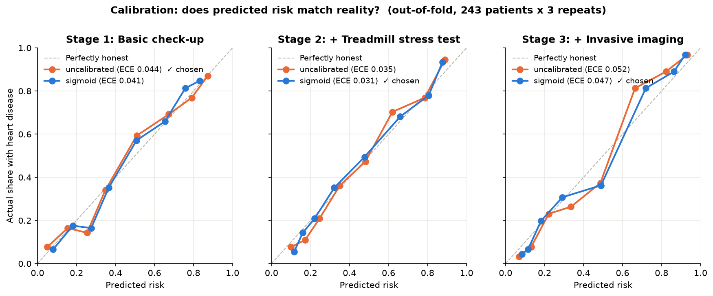
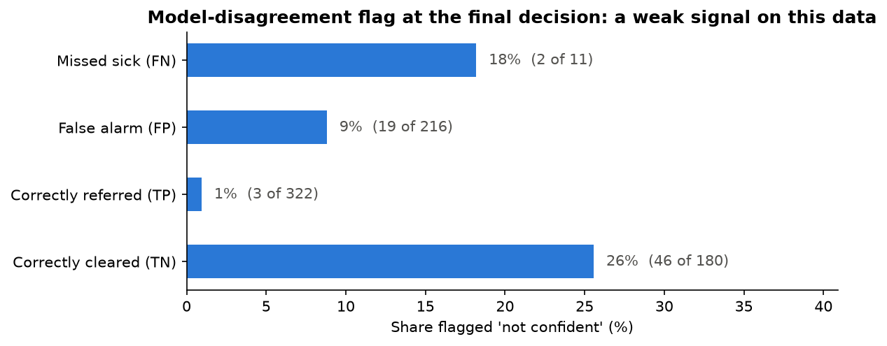

# Phase 5: Honest Probabilities & "Not Sure" Answers

**Goal:** make CardioStage's risk numbers trustworthy, and give it ways to say *"don't rely on me here."*

**Files in this phase**

| File | Job |
|---|---|
| `src/cardiostage/calibration.py` | Calibration experiment, uncertainty evaluation, unusual-patient rates, final models |
| `src/cardiostage/uncertainty.py` | `SubsampleEnsemble` (model disagreement) and `NoveltyDetector` (unusual patients) |
| `tests/test_uncertainty.py` | 7 checks |
| `models/stage{1,2,3}.joblib` | Now contain: calibrated model + uncertainty copies + unusual-patient detector + zones |

```bash
python -m cardiostage.calibration                 # full run, ~6 minutes
python -m cardiostage.calibration --report-only   # regenerate tables/charts in seconds
```

---

## 1. What "calibrated" means

A model is **calibrated** if its numbers mean what they say: among all patients it calls "30% risk", about 30% really have heart disease.

This is different from **ranking** (ROC-AUC). Imagine two models:
- Model A says 90% for every sick patient and 80% for every healthy one. Ranking is perfect (AUC = 1.0), but telling a healthy person "80% risk" is terrifying and false.
- Model B says 60% and 10%. Same perfect ranking, *and* honest numbers.

Doctors and patients read **the number**, so it has to be honest. CardioStage's app will show it.

### How we measure it
| Measure | Idea | Lower is better |
|---|---|---|
| **Reliability curve** | Group patients by predicted risk; plot average prediction vs actual disease rate. A perfect model sits on the diagonal | Closer to diagonal |
| **ECE** (expected calibration error) | The average gap between predicted and actual rate across those groups. ECE 0.05 ≈ off by 5 percentage points | ✓ |
| **Brier score** | Average of (probability − outcome)². Rewards being *both* accurate and honest | ✓ |
| **Log loss** | Like Brier, but punishes confident mistakes much harder | ✓ |

### How calibration is fixed
A **calibrator** is a small second model that learns to correct the first model's probabilities:
- **Sigmoid (Platt scaling):** fits a smooth S-shaped correction. Only 2 parameters, so it's safe on small data.
- **Isotonic regression:** fits any staircase-shaped increasing correction. Very flexible, but needs lots of data, and with little data it overfits.

**Crucial detail:** the calibrator must learn from patients the model *didn't train on*. A model is always overconfident on its own training patients, so correcting it there teaches the wrong lesson. `CalibratedClassifierCV` handles this with an internal 5-fold split.

## 2. Calibration results



Scores on all out-of-fold predictions pooled (729 per stage):

| Stage | Variant | Brier | ECE | ROC-AUC |
|---|---|---|---|---|
| 1 | **uncalibrated ✓** | **0.1643** | 0.044 | 0.835 |
| 1 | sigmoid | 0.1664 | 0.041 | 0.831 |
| 1 | isotonic | 0.1676 | 0.066 | 0.826 |
| 2 | uncalibrated | 0.1568 | 0.035 | 0.851 |
| 2 | **sigmoid ✓** | **0.1564** | 0.031 | 0.851 |
| 3 | uncalibrated | 0.1293 | 0.052 | 0.896 |
| 3 | **sigmoid ✓** | **0.1265** | 0.047 | 0.898 |

**What we learned:**
1. **The models were already fairly honest** (ECE 0.035–0.052). Logistic regression is naturally well calibrated, since its training directly optimises log loss, and averaging models (the ensemble) also tends to give moderate, sensible probabilities.
2. **Sigmoid calibration helped stages 2–3 a little** and was kept there. Stage 1 stays uncalibrated: sigmoid slightly lowered its ECE but worsened its Brier score. We choose by Brier because it judges calibration *and* ranking together.
3. **Isotonic overfit**, as expected on small data. Its log loss jumped to ~0.7, meaning it made some very confident mistakes. That's why sigmoid is the usual choice for datasets this size.

### A lesson about noisy metrics
My first run reported ECE averaged over each of the 15 folds: about 0.13, which looked alarming. But each fold has only ~49 patients, split into 10 bins of ~5 patients each. With 5 patients, the "actual disease rate" of a bin can only be 0%, 20%, 40%..., so random noise alone produces gaps of 0.1+. Measured on all predictions pooled (~73 per bin), the true ECE is 0.035–0.052.
**Always ask whether a metric has enough data behind it to mean anything.**

## 3. Thresholds re-derived on calibrated probabilities

| Stage | Clear if risk below | Refer if risk at least | Otherwise |
|---|---|---|---|
| 1. Basic | 9.0% | 83.0% | → treadmill |
| 2. + Treadmill | 13.4% | 78.2% | → invasive tests |
| 3. + Invasive | | **14.8%** | (final decision) |

Notice how low the stage 3 threshold is: anyone with ≥ 14.8% calibrated risk is referred. That's the cost of catching 97% of sick patients, and it's honest. A 15% chance of heart disease *is* worth a cardiologist's attention.

## 4. Updated strategy comparison

| Strategy | Recall | Sick missed | Specificity | Healthy flagged | Need invasive |
|---|---|---|---|---|---|
| Everyone: all tests | 0.973 | 3 | 0.447 | 73 | 100% |
| **CardioStage staged** | **0.964** | **4** | **0.470** | **70** | **60%** |

Bootstrap 95% CIs for (staged − all tests): recall −0.009 [−0.029, 0.000], specificity +0.023 [0.000, +0.052], invasive tests **−40% [−46%, −33%]**.
Calibration slightly improved the policy: fewer invasive tests than Phase 4 (60% vs 63%) and fewer false alarms.

## 5. "Not sure" #1: model disagreement

**Idea:** train 20 copies of each stage model, each on a random 80% of the training patients. For a new patient, the copies give 20 probabilities. The middle 80% of them (10th–90th percentile) is the patient's **plausible risk range**. If that range crosses the decision threshold, the decision "depends on luck in which patients we trained on".

Copies use 80% sampling *without* replacement (not a bootstrap), so no patient appears twice. Each copy's calibrator runs its own cross-validation, and a duplicated patient could land on both sides of a split.

**Does it catch mistakes?** We checked honestly, at the final stage 3 decision, using copies that never saw the patient:



| Outcome | Flagged "not confident" |
|---|---|
| Missed sick patients | 18% (2 of 11) |
| False alarms | 9% |
| Correctly referred | 1% |
| Correctly cleared healthy | 26% |

**Verdict: a weak signal on this data.** It rarely fires on clear-cut sick patients (good), but it fires on many correctly-cleared healthy patients too, and catches only 2 of 11 misses. The copies mostly agree: the typical range is just 6.7 percentage points wide. With only 11 misses to study, we can't claim it reliably detects errors.

**Why "error rate" was the wrong first check:** at a 97%-recall threshold, most "errors" are deliberate false alarms that the threshold accepts by design. The question that matters is whether it catches the *dangerous* error, missed sick patients. Choose evaluation metrics that match the real-world cost of each mistake.

**Decision (yours):** the app **shows** the plausible range for transparency (e.g. *"14% risk, plausible range 11–18%"*) but **doesn't let it change decisions**. Used as a safety guard it caught 1 more sick patient out of 111, but raised invasive tests from 60% to 72%. Recorded in `config.USE_UNCERTAINTY_GUARD = False`.

## 6. "Not sure" #2: unusual patients

A model can only learn from the patients it saw. For someone unlike any of them, its probability is a guess dressed up as precision. `NoveltyDetector` gives two kinds of human-readable warning:

1. **Range check:** a measurement outside anything seen in training. *"chol = 900 is outside the training range (126 to 564)"*.
2. **Unusual combination (Isolation Forest):** randomly split the data again and again. Typical patients sit in crowded regions and take many splits to isolate; odd ones get isolated quickly. This catches combinations that are unusual even when each value alone is normal (e.g. age 30 with a max heart rate of 80). The cut-off flags the most unusual ~1% of training patients.

**Validation with real "different" patients.** The other hospitals were never used for training, so they're a natural test:

| Share flagged unusual | Stage 1 | Stage 2 | Stage 3 |
|---|---|---|---|
| Cleveland (training) | 1.2% | 1.2% | 1.2% |
| Hungary | 2.4% | 1.4% | 2.4% |
| VA Long Beach | 2.0% | 4.0% | 7.5% |
| Switzerland | 0.8% | **13.0%** | **13.0%** |

The detector fires **more on hospitals with different patient populations**: Switzerland (93% sick, unusual ECG patterns including the negative ST values from Phase 2) and VA, and barely more on Hungary, whose patients look most like Cleveland's. A good sign that it's measuring something real. Phase 6 tests whether flagged patients are indeed predicted worse.

## 7. Check your understanding
1. A model has ROC-AUC 0.95 but ECE 0.25. What does that mean for a patient?
2. Why must the calibrator learn from patients the model didn't train on?
3. Why did isotonic calibration do worse than sigmoid here?
4. Why was per-fold ECE (0.13) misleading?
5. Why don't we let the uncertainty range change decisions?

## Answers

**1.** It ranks patients very well: sick patients usually score higher than healthy ones. But its numbers are off by about 25 percentage points on average. A patient told "70% risk" might really have a 45% chance. Fine for sorting a waiting list, misleading for telling a person their risk.

**2.** On its own training patients a model is overconfident: it has partly memorised them. A calibrator learning from those predictions would learn the model is *more* accurate than it really is, and would fail to correct the overconfidence on new patients. Held-out patients show its true behaviour.

**3.** Isotonic regression can fit any increasing staircase shape, so with ~200 patients per calibration fold it fits random wiggles in the data (overfitting). That leads to some extreme probabilities (near 0 or 1) on new patients, which log loss punishes heavily. Sigmoid has only 2 parameters, so it can't overfit much.

**4.** Each fold had ~49 patients split into 10 bins, about 5 per bin. A bin's actual disease rate could then only be 0%, 20%, 40%..., so random noise alone created large gaps. Pooling all out-of-fold predictions (~73 per bin) gave a reliable estimate of 0.035–0.052.

**5.** We tested whether it identifies mistakes, and on this data it does so only weakly (2 of 11 missed patients flagged, plus many correct decisions). Letting it change decisions would cost many extra invasive tests for a gain we can't reliably demonstrate. Showing the range keeps the model transparent without overclaiming.
