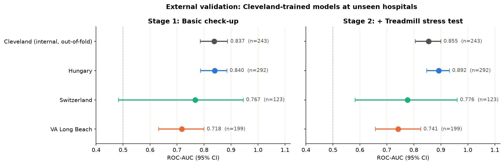
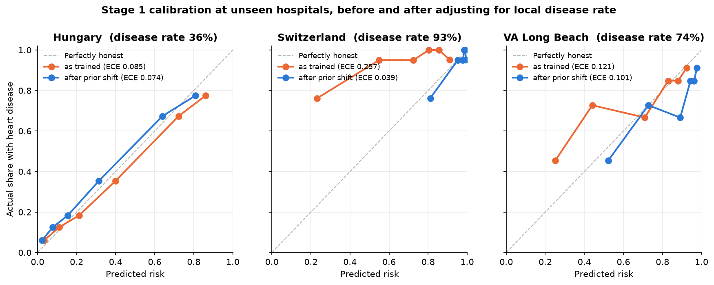
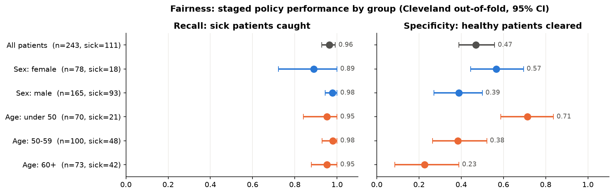

# Phase 6: New Hospitals & Fairness

**Goal:** answer the two questions every medical AI must face:
1. **Does it work somewhere new?** (feature B: external validation)
2. **Does it work for everyone?** (feature F: fairness)

**Files in this phase**

| File | Job |
|---|---|
| `src/cardiostage/stats.py` | Bootstrap confidence intervals; prior-shift adjustment |
| `src/cardiostage/external_validation.py` | Runs the Cleveland-trained stage models on the 3 unseen hospitals |
| `src/cardiostage/fairness.py` | Compares performance by sex and age group |
| `tests/test_stats.py` | 6 checks |

```bash
python -m cardiostage.external_validation
python -m cardiostage.fairness
```

---

## Part A: External validation

### Why it matters
Everything so far was measured on Cleveland patients. Even with careful cross-validation, those patients share a hospital, staff, equipment, referral habits and region. Medical AI has a long history of models that shone in their home hospital and failed elsewhere. **External validation** (applying the model, *unchanged*, to a different hospital's patients) is the strongest evidence short of a clinical trial.

Our models never saw a single patient from Hungary, Switzerland or VA Long Beach.

**Only stages 1–2 can be tested.** Stage 3's tests are largely missing outside Cleveland (blocked vessels `ca`: 96–99%; thallium scan `thal`: 42–90%), so "results" would mostly measure our gap-filling.

### Ranking: who generalises?



| Hospital | Disease rate | Stage 1 AUC | Stage 2 AUC |
|---|---|---|---|
| Cleveland (internal, out-of-fold) | 46% | 0.837 [0.786, 0.887] | 0.855 [0.805, 0.900] |
| **Hungary** | 36% | **0.840** [0.787, 0.885] | **0.892** [0.848, 0.932] |
| Switzerland | 93% | 0.767 [0.483, 0.946] | 0.776 [0.583, 0.961] |
| VA Long Beach | 74% | 0.718 [0.632, 0.800] | 0.741 [0.657, 0.826] |

**Reading the results:**
- **Hungary: excellent transfer.** Stage 1 matches Cleveland, and stage 2 is even better. Its patients resemble Cleveland's (similar disease rate, complete records).
- **VA Long Beach: a clear drop** (0.72–0.74). VA's patients are 97% male veterans, 74% sick, and are missing ~28% of blood pressure, cholesterol and treadmill values (filled with Cleveland medians). The model is working with poorer information about a different population.
- **Switzerland: we genuinely don't know.** Only **8 of 123 patients are healthy**. ROC-AUC compares sick vs healthy, so with 8 healthy people the interval spans 0.48–0.95, from coin flip to excellent. Reporting "0.77" without the interval would be misleading. **Always ask how many patients are behind a number, in *both* classes.**

### Honesty: the probabilities shift with the hospital



| Hospital | Actual rate | Model's average prediction | ECE as trained | ECE after prior shift |
|---|---|---|---|---|
| Hungary | 36% | 39% | 0.085 | 0.074 |
| VA Long Beach | 74% | 67% | 0.121 | 0.101 |
| Switzerland | 93% | 68% | **0.257** | **0.039** |
(stage 1; stage 2 is similar)

The model **under-predicts at high-disease hospitals**. It learned Cleveland's starting point, where 46% are sick. A Swiss patient starts from a much higher "before any tests" chance, because that clinic mostly saw already-suspected cases.

**The fix, prior shift (Bayes' rule):** if you know a hospital's overall disease rate, adjust every prediction's *odds*:

```
new odds = model odds × (local odds ÷ training odds)
```

Example: a Swiss patient gets 50% from the model (odds 1). Local odds = 0.93/0.07 ≈ 13.3; training odds = 0.46/0.54 ≈ 0.85. New odds ≈ 15.6 → **94%**.

This fixed Switzerland's calibration (0.257 → 0.039) **using only one number**, the local disease rate, with no local retraining. It doesn't change the ranking, only the honesty of the numbers. In practice a hospital adopting CardioStage would supply its disease rate. Here it's a demonstration, not built into the app.

### Decisions: is the "clear" zone still safe?

| Hospital (stage 1) | Cleared at stage 1 | …of whom actually sick | Safety of "cleared" (NPV) |
|---|---|---|---|
| Cleveland (out-of-fold) | 11% | 1 | 96% |
| **Hungary** | 21% | **6** | **90%** |
| VA Long Beach | 0.5% | 0 | n/a |
| Switzerland | 1% | 1 | n/a |

**Important finding:** at Hungary the stage-1 clear zone is less safe. It clears twice as many patients, and 6 of them are sick. Hungary's lower disease rate pushes more patients under the "clear" cutoff, so a cutoff tuned on Cleveland behaves differently. At stage 2 Hungary is safer again (2 sick cleared, NPV 96%). **Lesson:** decision thresholds are tuned to a population, and a hospital adopting CardioStage should re-check them on local data. The ranking transferred well; the cutoffs need local confirmation.

### Do the "unusual patient" warnings mean anything?

| External patients, stage 1 | n | Brier score (lower = better) |
|---|---|---|
| Typical | 602 | 0.161 |
| Flagged unusual | 12 | **0.221** |
| **External patients, stage 2** | | |
| Typical | 586 | 0.148 |
| Flagged unusual | 28 | **0.198** |

**Yes, but with small numbers.** Patients the detector flagged were predicted about 35% worse at both stages. With 12 and 28 flagged patients this is encouraging rather than conclusive, but it's consistent with the warning doing its job.

---

## Part B: Fairness

### Why it matters
A model can look good on average while failing a subgroup. Women are a third of Cleveland's patients (78 of 243 in training, only **18 of them sick**), and heart disease in women is known to be under-diagnosed, partly because women more often have "atypical" symptoms.

### Results (Cleveland out-of-fold, full staged policy)



| Group | n (sick) | Stage 3 AUC | Policy recall | Missed | Specificity |
|---|---|---|---|---|---|
| All | 243 (111) | 0.899 | 0.964 | 4 | 0.470 |
| Women | 78 (18) | 0.891 [0.804, 0.970] | 0.889 [0.722, 1.000] | 2 | 0.567 |
| Men | 165 (93) | 0.880 [0.823, 0.926] | 0.978 [0.944, 1.000] | 2 | 0.389 |
| Under 50 | 70 (21) | 0.930 | 0.952 | 1 | 0.714 |
| 50–59 | 100 (48) | 0.893 | 0.979 | 1 | 0.385 |
| 60+ | 73 (42) | 0.867 | 0.952 | 2 | **0.226** |

External hospitals pooled (stages 1–2): women AUC 0.86 / 0.85 vs men 0.81 / 0.85, **no ranking disadvantage for women.**

### Interpreting it carefully
**Ranking is equally good for women** (internal and external). The model sorts women by risk as well as men.

**Recall looks lower for women** (0.89 vs 0.98), but that rests on **2 missed women out of 18**. The interval (0.72–1.00) is too wide to establish a real gap. So we looked at the two individually:
1. **A 58-year-old woman with atypical chest pain, cleared at the basic check-up** (risk 7.1%, under the 9% cutoff). Her invasive test would have shown 2 blocked vessels (stage 3 risk 23%). **This mirrors the real-world under-diagnosis pattern**: atypical angina had only a 14% disease rate in the data, so the model learned to be reassured by it, and women present atypically more often.
2. **A 60-year-old woman exactly on the stage 3 threshold** (0.1484 vs a cutoff of 0.14846). A coin-edge case, not a pattern.

**Why we did NOT apply a "fix":** we tested a women-specific threshold. It "rescued" patient 2 only by moving the cutoff by 0.0001, a rounding artefact. Any rule designed to catch these two women would be fitted to two people: overfitting presented as fairness. The honest outcome is to **document it as a limitation to monitor**: early clearing of atypical presentations, especially in women, needs more data to evaluate properly.

**Older patients get more false alarms** (specificity 0.23 for 60+). Older people have higher disease rates and more risk factors, so at a 97% recall target, more healthy older people score above the cutoff. Recall stays high in every age group, so no group's sick patients are being neglected. The cost of caution falls on older healthy people as extra follow-up.

---

## Check your understanding
1. Why is external validation stronger evidence than cross-validation?
2. Switzerland's AUC is 0.77 [0.48, 0.95]. Why so wide, and what should we conclude?
3. How can prior shift fix calibration without changing the ranking?
4. Why is the stage-1 clear zone less safe at Hungary than at Cleveland?
5. Why didn't we adjust the model to catch the 2 missed women?

## Answers

**1.** Cross-validation tests on unseen *patients* from the *same* hospital, who share its equipment, staff, referral patterns and population. External validation tests on a different hospital entirely, so it reveals whether the model learned general medical patterns or local quirks. Many models that pass cross-validation fail this test.

**2.** ROC-AUC compares sick vs healthy patients, and Switzerland has only 8 healthy ones, so each one hugely affects the result. The honest conclusion is "we can't tell": performance could be anywhere from coin flip to excellent. We'd need more healthy Swiss patients to know.

**3.** Prior shift multiplies every patient's odds by the same factor. Multiplying by a positive constant never changes which patient has higher odds, so the ordering (and ROC-AUC) is unchanged. But all probabilities move up or down to match the local disease rate, which corrects the systematic under- or over-prediction.

**4.** The clear-zone cutoff was tuned so that almost no Cleveland sick patients fall below it. Hungary has fewer sick patients and a different mix, so more patients land below the same cutoff, including 6 sick ones. Cutoffs are tied to the population they were tuned on and need re-checking at a new site.

**5.** There were only 2, for different reasons: one a known atypical-presentation pattern, the other a borderline case at the exact threshold. A rule built to catch them would be tailored to two individuals and wouldn't reliably help future women. It could even hurt elsewhere. With so little data the responsible step is to document the limitation and flag it for monitoring, not to claim a fix.
