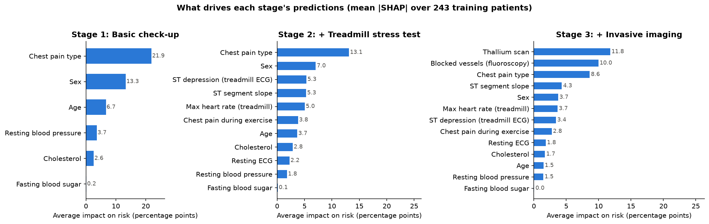
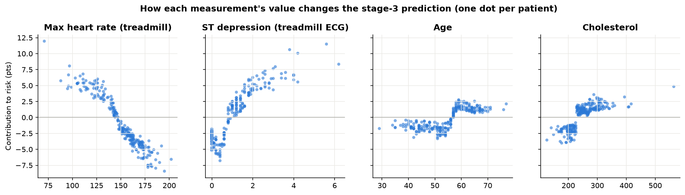
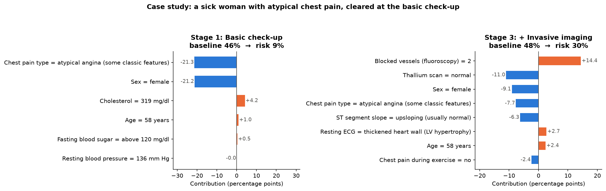

# Phase 7: Explanations (SHAP)

**Goal:** for every prediction, show *why*: which measurements pushed the risk up, which pushed it down, and by how much. Then use those explanations to check that the model reasons sensibly.

**Files in this phase**

| File | Job |
|---|---|
| `src/cardiostage/explain.py` | `StageExplainer`: SHAP explanations in plain English for any stage model |
| `src/cardiostage/explanations.py` | Global importance, effect shapes, sanity checks, case study |
| `tests/test_explain.py` | 5 checks (including "contributions add up exactly") |

```bash
python -m cardiostage.explanations    # ~1-2 minutes
```

---

## 1. What SHAP is

**The question:** *"This patient got 34% risk. Which measurements caused that?"*

SHAP comes from **game theory**. Think of the measurements as players on a team, and the predicted risk as the team's score. How do you fairly split the credit? **Shapley values** (devised by Lloyd Shapley in 1953; he later shared the 2012 Nobel Prize in economics) answer: a player's fair share is its **average contribution across every possible order in which players could join the team**.

For a model: start from a "typical patient" prediction (the **baseline**), then reveal the patient's real measurements one at a time in random orders, recording how much each one moves the prediction. Average over many orders.

**Two properties make it ideal for medicine:**
1. **Additive:** baseline + all contributions = the patient's risk, *exactly*. Our runs confirm this to 15 decimal places.
2. **Fair:** a measurement that changes nothing gets 0; two measurements that act identically get equal credit.

**Example** (a real training patient, stage 3):
> Estimated risk **91%** (typical patient: 48%).
> Raising it: thallium scan = reversible defect **(+12 pts)**; chest pain type = no chest pain **(+8)**; ST depression = 3.4 mm **(+6)**; chest pain during exercise = yes **(+3)**.
> Lowering it: blocked vessels = 0 **(−3)**.

### How we made SHAP work for our models
- **Our stage 2–3 models are calibrated ensembles** (a calibration layer over an average of logistic regression, random forest and XGBoost). SHAP's fast model-specific shortcuts can't handle that, so we use the **permutation** method, which works with *any* model by simply calling its `predict_proba`. It costs about 1–3 seconds per patient, fine for an app.
- **We explain the 13 original measurements, not the 22 internal columns.** "Chest pain type" is one item, not four one-hot columns. To do this, categories are temporarily turned into integer codes for SHAP, then turned back into text before the model sees them (`encode`/`decode`).
- **The background ("typical patients")** is 50 training patients sampled in their true sick/healthy proportions. My first version drew 50 at random, and by chance got too many sick ones: a baseline of 51% vs the true 46%. Stratified sampling fixed it (46–48%).
- **Units are percentage points of probability.** "+12 pts" means the risk went from, say, 40% to 52% because of that measurement.

## 2. What drives each stage



| Rank | Stage 1 (basic) | Stage 2 (+ treadmill) | Stage 3 (+ invasive) |
|---|---|---|---|
| 1 | Chest pain type 21.9 | Chest pain type 13.1 | **Thallium scan 11.8** |
| 2 | **Sex 13.3** | Sex 7.0 | **Blocked vessels 10.0** |
| 3 | Age 6.7 | ST depression 5.3 | Chest pain type 8.6 |
| … | | | Sex 3.7 |
| last | Blood sugar 0.2 | Blood sugar 0.1 | Blood sugar 0.0 |

(average impact on risk, percentage points)

**Three insights:**
1. **As real test results arrive, demographics matter less.** Sex drops from 13.3 → 7.0 → 3.7 points, and age from 6.7 → 3.7 → 1.5. With little information, the model leans on *who you are* (group averages). With direct evidence about *your heart*, it leans on that instead. This is the strongest argument for staged testing: **more information means less reliance on demographic generalisations.**
2. **Invasive tests dominate stage 3**, consistent with Phase 4's finding that they add the most.
3. **Fasting blood sugar barely matters** (~0). Only 15% of patients have high blood sugar, and its information overlaps with other features.

## 3. How effects behave



Each dot is one patient: the x-axis is their measurement, the y-axis is how much it moved their stage 3 risk.
- **Max heart rate:** a smooth, strong downward trend, from about +12 pts at 70 bpm to −8 pts at 190+ bpm. A heart that can't speed up under stress is a warning sign.
- **ST depression:** a steady rise. Bigger ECG dips mean more risk.
- **Age** and **cholesterol** show **steps** (around 57 years and 230 mg/dl). That's the fingerprint of the **tree models** in the ensemble: trees split on thresholds, so they create step-shaped effects rather than smooth curves. Medically the true effect is surely smooth. The steps are an artefact of the model type, and a reason not to over-interpret exact cut-points.

## 4. Sanity checks: does it reason like a cardiologist?

We wrote 12 checks of the direction each feature *should* push risk, from cardiology and Phase 2's exploration. **All 12 pass.**

| Check | Result |
|---|---|
| Higher max heart rate lowers risk | ✅ (correlation −0.96) |
| More ST depression raises risk | ✅ (+0.90) |
| More blocked vessels raise risk | ✅ (+0.92) |
| Older age raises risk | ✅ |
| Higher blood pressure raises risk | ✅ |
| Male sex, exercise chest pain raise risk | ✅ |
| Reversible thallium defect raises risk; normal scan lowers it | ✅ |
| Upsloping ST segment lowers risk | ✅ |
| **No chest pain raises risk** (the referral paradox) | ✅ |
| Atypical angina lowers risk | ✅ |

The last two pass because **the model faithfully learned the referral patterns in the data** (Phase 2): among referred patients, "no chest pain" signals other alarming findings. That's correct *for this population*, but it would be wrong to apply to the general public. Explanations make such learned patterns **visible**, which is the point.

## 5. Case study: why was she cleared?

In Phase 6 a sick 58-year-old woman with atypical chest pain was cleared at the basic check-up. SHAP shows exactly why:



**Stage 1:** baseline 46% → **9%**
- Atypical angina: **−21 pts**
- Female: **−21 pts**
- Cholesterol 319: +4 pts

Two features, each pulling hard in the same direction, pushed her below the clear-zone cutoff. Each is a reasonable average pattern (atypical angina had a 14% disease rate; women 23%), but **combined, they compounded into false reassurance.** This is exactly how the real-world under-diagnosis of women plays out.

**Stage 3:** baseline 48% → **30%**
- **2 blocked vessels: +14 pts** (the decisive evidence)
- Female drops to −9 and atypical angina to −8: once direct evidence exists, demographics matter less.

She'd be referred at stage 3 (threshold 14.8%).

(Note: these numbers come from the *final* models, which trained on all 243 patients including her, so they differ slightly from the out-of-fold values in Phase 6: 7.1% and 22.8%.)

**What this teaches:** explanations turn "the model made a mistake" into "**here's the mechanism**". A clinician seeing *"lowered mostly by: female, atypical chest pain"* can apply their own judgement, which is the purpose of showing explanations in the app.

## 6. Important caveat: explanations describe the *model*, not the *body*
SHAP tells you what drove **the model's** prediction. It does **not** say that changing a measurement would change your real risk. "Female: −21 pts" doesn't mean being female protects you by 21 points. It means the model, having seen mostly lower disease rates in women *in this referral dataset*, lowered the estimate. Correlation, not causation. The app will say this explicitly.

## 7. Check your understanding
1. What does "additive" mean for SHAP, and why is it useful in an app?
2. Why does the importance of sex shrink from stage 1 to stage 3?
3. Why are the age and cholesterol effects step-shaped?
4. The model says "no chest pain: +8 pts". Does that mean chest pain is protective?
5. Why did we need to `encode` categories before using SHAP?

## Answers

**1.** Baseline + every contribution = exactly the patient's predicted risk. In an app this means the explanation fully accounts for the number shown. Nothing is hidden or unexplained, so a user can check that the parts sum to the whole.

**2.** At stage 1 the model has little direct information about the heart, so it relies on group-level patterns such as "women in this data had lower disease rates". At stage 3, test results describe *this* patient's heart directly, so the model needs demographics less, and their contributions shrink.

**3.** Two of the three ensemble members (random forest and XGBoost) are tree models, which make predictions by splitting on thresholds ("age > 57?"). Thresholds create jumps rather than smooth curves. The true biological effect is almost certainly gradual. The steps reflect how trees work.

**4.** No. It reflects the referral dataset: patients without chest pain were usually referred because of *other* alarming findings, so in this population "no chest pain" is associated with more disease. SHAP explains the model's learned association, not a medical cause, and the pattern wouldn't apply to the general public.

**5.** SHAP's masker works with numeric arrays, mixing in values from background patients. Text categories like "atypical angina" can't go in a numeric array. We map each category to an integer code for SHAP, and decode back to text before calling the model, so each original measurement stays a single explanation item.
