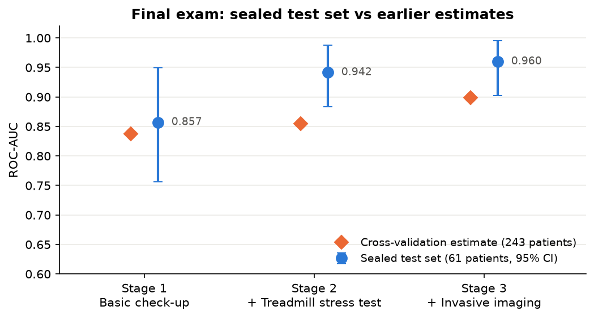

# Phase 9: Final Evaluation & Polish

**Goal:** get the one truly unbiased measurement of CardioStage, then make the project ready for others to read, run and judge.

**Files in this phase**

| File | Job |
|---|---|
| `src/cardiostage/final_evaluation.py` | Opens the sealed test set, once |
| `src/cardiostage/stats.py` | New `exact_proportion_ci` (Clopper–Pearson intervals) |
| `pyproject.toml` | `ruff` linter/formatter settings |
| `LICENSE` | MIT for the code; CC BY 4.0 noted for the data |
| `docs/learning/README.md` | Index of all guides |

```bash
python -m cardiostage.final_evaluation
ruff check src tests app     # lint
ruff format src tests app    # auto-format
```

---

## 1. The final exam

Since Phase 3, **61 Cleveland patients** (28 sick) were locked away. Every model, hyperparameter, calibration method, threshold and design decision in Phases 3–8 was made without them. Phase 9 used them **exactly once**, with the final models and **frozen** thresholds.

### Stage models



| Stage | Sealed test ROC-AUC | Earlier CV estimate |
|---|---|---|
| 1. Basic check-up | 0.857 [0.756, 0.949] | 0.837 |
| 2. + Treadmill | 0.942 [0.884, 0.988] | 0.855 |
| 3. + Invasive | 0.960 [0.902, 0.996] | 0.899 |

### The staged policy (thresholds frozen from training)

| Strategy | Sick missed (of 28) | Recall | Specificity | Need invasive |
|---|---|---|---|---|
| Everyone: all tests | 0 | 1.000 [0.877, 1.000] | 0.455 | 100% |
| **CardioStage staged** | **0** | **1.000 [0.877, 1.000]** | **0.515** | **49%** |

| Where test patients stopped | Cleared | Referred |
|---|---|---|
| Stage 1 (check-up) | 8 | 11 |
| Stage 2 (treadmill) | 5 | 7 |
| Stage 3 (invasive) | 4 | 26 |

**No sick patient was missed, and half the patients never needed invasive tests.**

### How to read a test score that's *better* than expected
All three stages scored above their cross-validation estimates, and at stage 2 the CV estimate even falls just outside the test interval. Tempting as it is, this **doesn't** mean the model is better than we thought:
- 61 patients is a small sample. One group of 61 can easily be a bit easier than average.
- **Overfitting shows up as test scores *below* the earlier estimates.** We see the opposite, which is reassuring: nothing leaked, and the earlier estimates weren't inflated.
- So the honest headline uses the **cross-validation estimates** (243 patients, more stable) as the expectation, with the test set as confirmation.

### Exact confidence intervals: when the bootstrap breaks
My first run reported recall as **1.000 [1.000, 1.000]**, claiming certainty. With zero misses, every bootstrap resample also has zero misses, so the bootstrap simply cannot express doubt.

But catching 28 of 28 doesn't prove a recall of 100%. If the true recall were 92%, the chance of catching all 28 would still be 0.92²⁸ ≈ 10%, not rare at all. The **Clopper–Pearson exact interval** answers the right question, *"which true rates make 28/28 plausible?"*, and gives **87.7% to 100%**.

**Lesson:** the bootstrap struggles at the edges (0% or 100%) and with very small counts. For a simple proportion (k successes out of n), use an exact or Wilson interval.

## 2. Code quality with `ruff`
`ruff` is a fast Python linter and formatter. Its first pass found 32 issues:
- **6 unused imports** and **7 unsorted import blocks:** clutter, auto-fixed.
- **17 places with two statements on one line** (`a(); b()`): harder to read, so the formatter split them.
- **2 lambdas assigned to names:** Python style prefers named functions with a docstring, so they were rewritten.

After formatting 24 files, **all 59 tests still passed**. That's the value of a test suite: it lets you make large mechanical changes with confidence.

One thing was checked by hand, not trusted to the tool: every plotting module must call `matplotlib.use("Agg")` **before** importing `pyplot`. An import sorter that reordered those lines would break chart generation on machines without a display. They were left in the right order.

## 3. Presenting ML work
What makes a portfolio project stand out isn't the highest number. It's **credibility**:
- **One-sentence pitch** at the top of the README.
- **Headline result with uncertainty**, not a bare number.
- **A clear method**: sealed test set, nested CV, external validation.
- **Honest limitations**, stated up front. Reviewers trust a project more when it shows where it fails.
- **Reproducible**: `pip install`, `train_all`, `pytest`, `streamlit run`, and the same numbers come out.

Interview talking points this project gives you:
1. *"Why is your recall CI 88–100% when you caught every patient?"* Exact intervals vs the bootstrap.
2. *"Why didn't XGBoost win?"* Small data: the simpler model was at least as good.
3. *"How do you know it works elsewhere?"* External validation at three hospitals, including where it struggled (VA) and where we can't tell (Switzerland).
4. *"Is it fair?"* Subgroup analysis, and why a rule fitted to 2 patients would be overfitting, not fairness.
5. *"What's novel?"* Staged testing that spares about half of patients invasive imaging at matched recall.

## 4. Check your understanding
1. Why can the sealed test set be used only once?
2. The test AUC beat the CV estimate. Why isn't that evidence the model is better than thought?
3. Why did the bootstrap give [1.000, 1.000] for recall, and why is that wrong?
4. Why run the full test suite after auto-formatting?

## Answers

**1.** If we looked at test results and then changed anything (a threshold, a model, a feature), the test set would have influenced the design, and its score would no longer be an unbiased estimate of performance on new patients. Using it once, after everything is frozen, keeps it a true "unseen" measurement.

**2.** With only 61 patients the test score has a lot of random variation, and this sample may simply have been easier. The informative direction is the opposite one: a test score far *below* CV would signal overfitting or leakage. A higher score is consistent with chance, so the more stable CV estimate remains the honest expectation.

**3.** Every resample of 28 sick patients who were all caught also has all patients caught, so every bootstrap recall is 1.0. The bootstrap can only reshuffle the observed data, and it can't imagine a miss it never saw. But a true recall below 100% (e.g. 92%) could easily produce 28/28 by chance. The exact interval (87.7%–100%) accounts for this.

**4.** Formatting tools rewrite many lines automatically. Although they're designed not to change behaviour, import reordering and similar fixes can occasionally matter (e.g. `matplotlib.use` must run before importing `pyplot`). Passing tests confirm that nothing broke.
